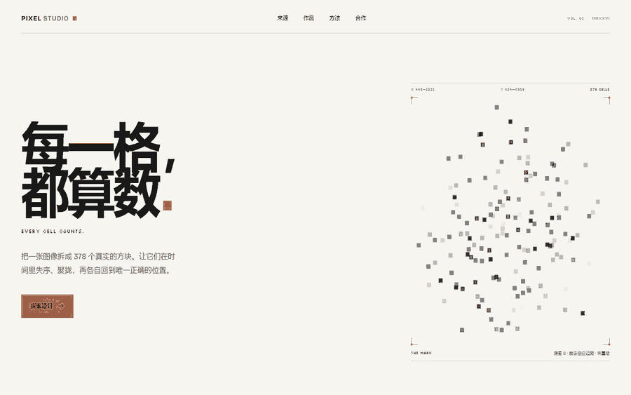
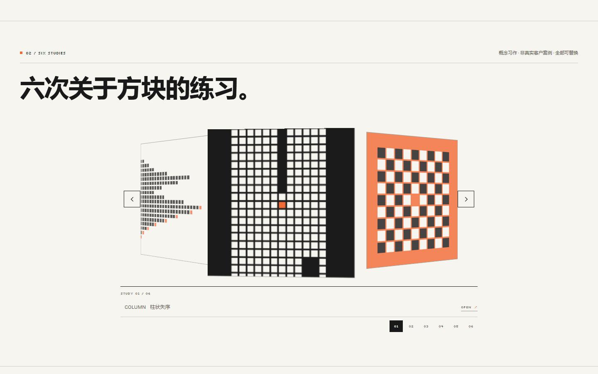
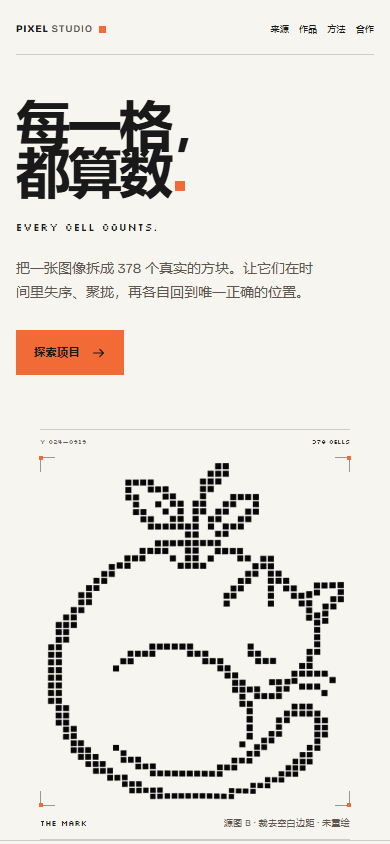

# PIXEL STUDIO

**378 cells. One canvas. Zero runtime dependencies.**

A pixel mark extracted from a real image, deconstructed into 378 measured
squares, and rebuilt in the browser. No React, no framework, no build step.

[Live demo](https://baiju111.github.io/baiju-pages/) ·
[GitHub](https://github.com/baiju111/baiju-pages) ·
[How it works](#how-it-works) ·
[Run locally](#run-locally) ·
[中文说明](README.zh-CN.md)

[](https://baiju111.github.io/baiju-pages/)


[](https://github.com/baiju111/baiju-pages/actions/workflows/check.yml)



## What this is

PIXEL STUDIO is a one-page experiment about deconstruction and return. A single
source image is read as 378 real, 4-connected square components. Their measured
centres, colours, and outline flags become the animation's fixed targets. The
page then runs a 5.6 second sequence — awakening, converging, outlining,
rearranging, settling — before handing off to the transparent master.

The works section is a separate native `<circular-carousel>` custom element:
a 3D cylinder, drag-to-spin, snap-to-nearest, keyboard navigation, flip faces,
and a reduced-motion mode. It is not a React component and does not use React
Bits source code.



## How it works

```text
B (1672×941 JPEG)
  → luminance threshold < 190
  → 378 4-connected foreground components
  → measured centre, size, colour, outline flag
  → transparent master + cell data
  → Canvas 2D phase timeline
  → final  handoff
```

A few details make the result specific rather than decorative:

- The source is **not** a perfect lattice. Block centres drift by several
  pixels, so the site preserves every measured centre instead of snapping to a
  synthetic grid.
- B has a baked white background and no alpha channel. The transparent master
  is reconstructed from the white matte; it is a reconstruction, not recovered
  original alpha.
- The final PNG is 824×928. The transparent gaps between squares are part of
  the artwork, not a CSS grid.
- The canvas is the animation layer. When the sequence ends, the transparent
  PNG takes over as the final image.
- The carousel is independent of the hero. It renders six 1:1 study cards and
  flips them after centring, rather than flipping while off-axis.

## Run locally

The site has no runtime dependencies and no build step.

```powershell
python -m http.server 8765
```

Open [http://127.0.0.1:8765/](http://127.0.0.1:8765/).

Opening `index.html` directly also works in current Chrome, but a local HTTP
server avoids `file://` font-loading warnings and is the recommended preview.

GitHub Pages, Netlify, Vercel, or any static host can serve the folder as-is.
No Node, PHP, or server-side runtime is required to view the site.

## Controls

**Hero**

- Click / tap the artwork: replay from the beginning.
- `Enter` while the artwork is focused: replay.
- `Space` while the artwork is focused: pause / resume.
- Pointer move or touch-and-hold: disturb local squares; they settle back.
- Strength is fixed to medium; there is no visible control strip.

**Works carousel**

- Auto-rotates at 14 seconds per revolution while idle and in view.
- Pauses on hover, keyboard focus, touch, drag, and flip.
- Drag more than 5px to spin; release to snap to the nearest card.
- Click a card to centre it, then flip it. Click again or press `Esc` to flip back.
- Arrow keys change cards; `Home` / `End` jump to the ends; `Enter` / `Space`
  flip the focused card.
- Number buttons 01–06 jump directly to a card.
- Desktop shows arrows; below 960px the arrows are hidden and drag / number
  buttons / keyboard remain.
- Reduced motion disables auto-rotation, intro motion, and momentum.

## Project structure

```text
index.html
css/
  site.css
  components/circular-carousel.css
js/
  main.js
  logo-data.js
  works.js
  components/circular-carousel.js
assets/
  logo-mark.png
  logo-data.json
  source/logo-b.jpg
  works/study-01.svg … study-06.svg
  fonts/*.ttf
scripts/
  extract_logo.py
  make_studies.py
tests/
docs/media/
```

## Customize

**Works**

Replace the SVGs in `assets/works/` or point `js/works.js` at new images. Cards
are 1:1 and use `object-fit: cover`, so keep the subject centred and allow edge
loss. Each item needs `src`, `alt`, `title`, and `subtitle`.

**Hero**

The hero is generated from a source image, not hand-authored per square:

1. Replace `assets/source/logo-b.jpg`.
2. Run `python scripts/extract_logo.py` (needs Python, NumPy, and Pillow).
3. Commit the regenerated `assets/logo-mark.png`, `assets/logo-data.json`, and
   `js/logo-data.js`.

If the new artwork has a different cell count or canvas size, update the
`378 CELLS` readout, image dimensions, alt text, and the acceptance tests too.
The engine reads the `cells` array, but the page copy is intentionally explicit
about the current artwork.

The current extraction is tuned for dark, separated square blocks on a white
or transparent background. A normal logo with connected strokes or a photograph
will not produce the same structure; that needs a different pixelation mode.

## Accessibility and performance

- Native buttons, links, and focusable artwork; no custom div-only controls.
- The hero phase is announced through a visually hidden live region.
- The carousel has a visually hidden status region and keyboard support.
- `prefers-reduced-motion: reduce` switches to a static/limited-motion path.
- If JavaScript fails, the static image and a plain list of works remain.
- Responsive at 1440, 768, and 390 px; no horizontal overflow.
- 378 `fillRect` calls per frame; device pixel ratio is capped at 2.
- All assets are local: no external fonts, images, analytics, or APIs.

<p>
  
</p>

Known trade-off: the carousel auto-rotates and has no visible pause button by
design. It pauses on hover, focus, touch, drag, and flip. If your context
requires WCAG 2.2.2, add a visible pause control or default to no auto-rotation.

## Tests

Start the local server, then run one test at a time:

```powershell
node tests/browser_test.mjs
node tests/resilience_test.mjs
node tests/keyboard_test.mjs
node tests/carousel_test.mjs
```

The tests use the installed Chrome over CDP; they do not require Playwright or
npm packages. Tests are optional for viewing the site. See
[ACCEPTANCE.md](ACCEPTANCE.md) for the current test record and known limits.

## Credits and license

- Code: [MIT](LICENSE).
- Source artwork B, `logo-mark.png`, and the six study SVGs: © 2026 PIXEL STUDIO.
  They are **not** covered by the MIT license. See [CREDITS.md](CREDITS.md).
- Bricolage Grotesque and Silkscreen are self-hosted under the SIL Open Font
  License 1.1; license files are in `assets/fonts/`.
- Circular carousel interaction was inspired by
  [React Bits Circular Carousel](https://reactbits.dev/components/circular-carousel).
  No source code was copied and no React dependency is used.

If this project inspired you or helped your own work, a star helps more people
find it.
